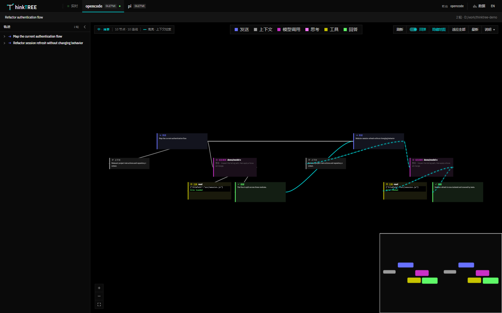
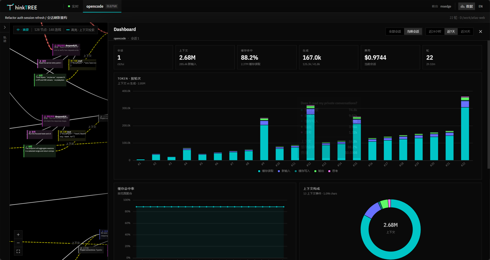

# thinkTREE

在终端里查上下文，不该靠 PageUp / PageDown。

CLI/TUI agent 的对话是一条很长的滚动日志。想回看上一轮提问、工具输出或模型思考，只能在终端里反复翻页，翻完还容易丢失当前位置。

thinkTREE 把当前会话变成一张可缩放、可拖动的工作轨迹图：左侧是完整对话树，右侧是无限画布，右下角有小地图；点一下就能回到对应位置。

> 只读本地数据，不上传、不截屏、无遥测。



## 为什么用它

**左侧轨迹树**

按轮次展开完整对话，查看提问、上下文、模型调用、思考、工具和回答。点击任意步骤，画布会自动定位到对应节点，不用再在终端里搜索或翻页。

**无限画布**

每个步骤是一个节点，因果与上下文关系用连线表示。可以自由缩放、平移和拖动，信息按空间位置组织，而不是挤在一条滚动日志里。

**右下角小地图**

显示整个会话的缩略图和当前视口。单击或拖动即可快速跳转，滚轮缩放，适合在长会话里快速回到某一轮。

**Dashboard**

需要看整体数据时打开右上角「数据」：token、缓存、上下文、费用、轮次和热力图，都集中在一个面板里。

## 使用方式

1. 启动后，在顶部 tab 选择正在运行的 agent。
2. 在左侧轨迹树展开某一轮，浏览该轮完整步骤。
3. 点击步骤，或拖动右下角小地图，快速定位画布位置。
4. 需要汇总数据时，打开 Dashboard。

多个 agent 同时运行时，会用 tab 分开显示。

## 快速开始

要求：

- Node.js >= 22.5
- Windows 10/11（进程与终端 tab 跟随相关功能）
- 其他平台可以运行，但部分 agent 跟随能力会降级

```bash
npm run web:install
npm run build:web
npm start
```

默认打开 `http://localhost:9178`。

没有本地 agent 时，可以用合成多轮数据预览界面：

```bash
npm run demo
```

Windows 也可以直接双击 `thinktree.bat`，通过菜单启动、停止或查看日志。

前端开发：

```bash
npm run dev:web
```

## 支持的 agent

| Agent | 状态 |
|---|---|
| **opencode（TUI）** | 作者主要测试平台 |
| **pi（CLI）** | 作者主要测试平台 |
| Codex | 已适配，未大量验证 |
| Kimi Code | 已适配，未大量验证 |
| ZCode | 已适配，未大量验证 |
| Cline | 已适配，未大量验证 |

本项目主要提供思路和适配框架。opencode TUI 和 pi CLI 是主要验证平台；其他 agent、不同版本或安装方式可能需要自行调整适配层。

## Dashboard

- **当前会话**：只看当前打开的会话。
- **全部会话**：按 24h / 7d / 30d 汇总该 agent 的历史会话。
- 包含 token、缓存命中、上下文构成、费用、轮次、热力图与会话明细。



## 隐私

- 只读取本机 agent 的本地会话存储
- 不上传会话内容
- 不截图 / OCR
- 无遥测

## License

项目代码采用 [MIT License](LICENSE)。

第三方开源组件与许可证见 [THIRD_PARTY_NOTICES.md](THIRD_PARTY_NOTICES.md)。
